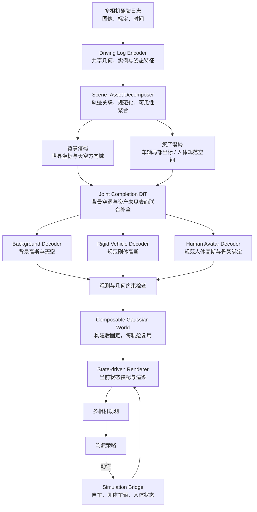

# 架构与数据流

按源码展开的[简化版与详细版 Mermaid 数据流程图](data-flow.md)包含查询布局、潜码补全、观测验证、固定世界持久化及在线闭环，可直接编辑对应的 `.mmd` 源文件。

## 研究问题

多相机驾驶日志只覆盖道路和资产的部分表面。新轨迹会暴露被遮挡的道路、车辆背面及人体衣物表面。DriveCompose 在离线阶段恢复并补全这些内容，在线阶段由仿真器独立推进状态，使不同轨迹使用同一个三维世界。

## 系统流程

## 模块责任

### Driving Log Encoder

图像共享一个编码干。图像内部注意力恢复局部结构，跨视图与跨时刻的摘要交互形成场景上下文。轨迹级实例槽记录固定身份，逐帧状态读取器输出该身份在每个时刻的根位姿与人体关节旋转。

已知相机内参和安装外参参与条件编码。世界位姿有两种输入方式：读取日志中的位姿，或估计以第一帧为原点的 rig 运动。尺度学习由标定基线与几何监督共同约束。实例槽数量定义资产容量，激活槽对应场景资产。

### Scene–Asset Decomposer

背景采用可靠深度抬升后的稀疏观测锚点，并保留有限空间网格作为补全支撑。车辆在固定局部包围体中结合观测锚点与补全网格。人体由同一身份模板提供规范表面和邻域查询。

每个规范查询被放到各个输入时刻，再投影到相应相机取特征。深度残差、实例身份、语义和几何置信度决定哪些观测可参与聚合。查询按已观测表面、已知自由空间与未知区域分组。

### Joint Completion DiT

各类型先经过自己的潜码编码器，映射到共同宽度。补全网络以类型、坐标、尺度、可见性和场景摘要为条件。局部查询组处理细节，全局记忆让背景、车辆和人体交换场景信息。

规范坐标用于保持资产身份；参考时刻的世界坐标用于表达资产与道路的关系。天空查询处于单位方向域，并携带相应类型标记。参考放置与场景上下文共同构成离线补全条件。

### 三路解码

Background Decoder 输出世界坐标高斯和天空立方体贴图。Rigid Vehicle Decoder 输出固定车辆局部高斯。Human Avatar Decoder 输出规范人体高斯，并继承规范支撑的骨架权重。每个支撑查询可产生多个高斯，其不透明度决定是否形成有效表面。

### Composable Gaussian World

`WorldVault` 保存固定背景、天空、规范资产、支撑范围和构建种子。`world.py` 使用数组与 JSON 元数据组织 NPZ 文件，读取参数为 `allow_pickle=False`。

### State-driven Renderer 与 Simulation Bridge

StateComposer 根据本步状态将活动资产放到世界中，随后统一渲染。车辆整体变换，人体先蒙皮再应用根位姿。外观使用与几何一致的局部观察方向。

Simulation Bridge 执行 `当前状态 → 观测 → 策略动作 → 动力学更新 → 下一状态`。其他交通参与者的交互状态也由动力学后端管理。重置轨迹只重置状态，复用原世界对象。

## 离线构建与在线运行

离线构建包含前馈恢复、多步补全和质量检查。在线路径执行确定性的状态装配与渲染。运行中的 `elapsed_seconds` 用于仿真计时，活动资产及其位姿由当前状态映射显式给出。

照明作为固定场景条件参与外观建模。
