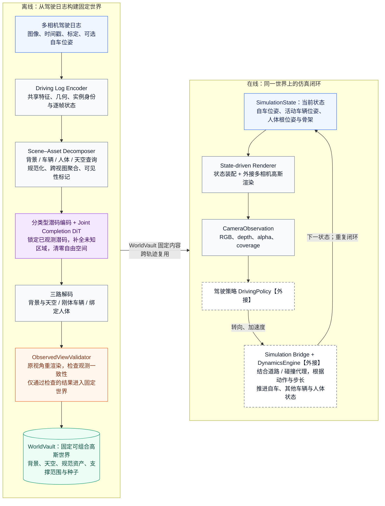
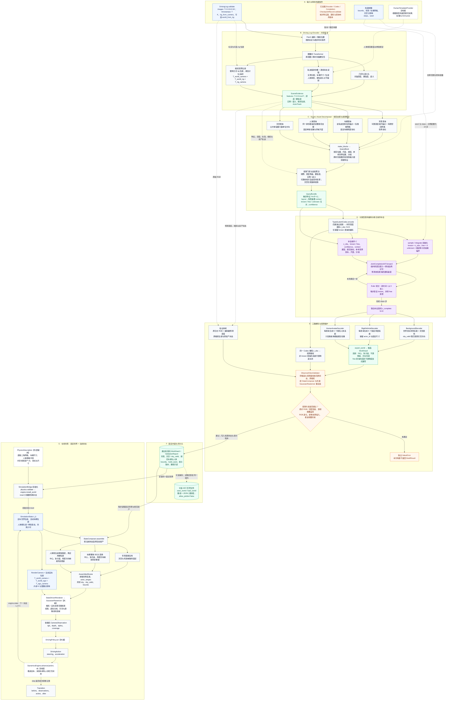

# DriveCompose Mermaid 数据流程图

依据当前项目的 `pipeline.py`、数据契约、网络模块及仿真代码整理。简化版用于说明整体机制，详细版用于逐步追踪数据、坐标空间、观测保护与在线状态更新。两版均覆盖离线推理与在线仿真；训练流程见 [training.md](training.md)。

## 简化版

读取顺序：左侧离线构建自上而下；固定 `WorldVault` 供右侧在线闭环跨轨迹复用。为保持总览紧凑，观测基线、失败出口、物理描述安装与相机变换在详细版展开。

[Mermaid 源文件](diagrams/data-flow-simple.mmd) · [SVG 矢量预览](diagrams/data-flow-simple.svg) · [PNG 预览](diagrams/data-flow-simple.png)

## 详细版

A–F 为离线世界构建，G 为在线仿真。实线表示主要数据流、顺序关系或状态反馈；虚线表示辅助条件、外部依赖或可选持久化。标有“外接”的节点为项目定义的接口，具体后端由调用方提供。完整流程较长，查看时可打开 SVG 放大。

[Mermaid 源文件](diagrams/data-flow-detailed.mmd) · [SVG 矢量预览](diagrams/data-flow-detailed.svg) · [PNG 预览](diagrams/data-flow-detailed.png)

## 图中数据的含义

| 数据 | 内容与坐标 / 张量契约 |
| --- | --- |
| `DrivingLog` | 多相机同步图像 `[T,V,3,H,W]`，时间戳 `[T]`，内参 `[V,3,3]`，安装外参 `[V,4,4]`，可选自车世界位姿 `[T,4,4]`。输入准备为线性 RGB 和针孔模型；畸变、滚动快门与曝光处理属于入口前的数据适配。 |
| `SceneEvidence` | 图像特征 `[T,V,h,w,F]`，光轴深度、置信度、实例与语义标签，相机世界位姿及轨迹级资产状态。法线由编码器头预测，但当前 `encode` 未将其导出到 `SceneEvidence`。 |
| `QueryBlock / QueryBundle` | 背景在世界坐标，车辆在固定局部坐标，人体在规范空间，天空在单位方向域。融合特征 `[N,F+1]` 的最后一维是归一化有符号深度残差；另存查询布局、观测标记、置信度和场景摘要。 |
| `z_obs / z_complete` | 潜码为 `[N,D]`。`known` 为可靠已见表面，`free` 为可靠自由空间，`unknown = ~(known | free)`。已见潜码每步锁定，自由空间每步清零；仅未知潜码随流积分更新。 |
| `GaussianSet` | 中心 `[M,3]`、正定协方差 `[M,3,3]`、不透明度 `[M]`、局部方向外观 `[M,3,4]`，以及观察方向到局部坐标的映射。单个非天空查询产生 K 个高斯。 |
| `WorldVault` | 固定背景、天空与 `sky_valid`、规范车辆和人体、支撑范围、构建种子与元数据。数组复制后设为只读。 |
| `SimulationState` | 本步自车位姿、活动车辆映射、人体根位姿与当前骨架，以及仿真计时；资产是否活动由状态映射显式确定。 |
| `CameraObservation / Transition` | 每相机输出 `rgb / depth / alpha / coverage`。`coverage` 表示支撑有效域。一步仿真返回 `before / observations / action / after`。 |

`T` 是输入时刻数，`V` 是相机数，`h,w` 是特征网格尺寸，`N` 是总查询数，`M` 是某个高斯集合的元素数。`configs/concept.json` 的示例参数为 `F=128`、融合特征宽度 129、`D=128`、`K=4`、采样 24 步；这些容量可通过模块和构建参数调整。构建入口接收参数，当前没有直接读取该 JSON 的总控脚本。

## 关键边界

- **补全与仿真分开执行。** `OfflineWorldBuilder.build` 完成编码、查询分解、潜码采样、解码和观测验证。在线 `observe / step` 读取同一份固定世界与当前状态；新 rollout 调用 `reset` 重置状态。
- **车辆与人体使用不同运动模型。** 车辆的尺寸、局部几何和外观固定，车轮随车体整体运动；人体保持规范形状与绑定，通过骨架蒙皮及根位姿变换运动。中心、协方差和方向映射同步更新。
- **构建检查有两份世界。** 同一个 codec 分别解码完整候选与仅观测基线；基线的非 `known` 高斯关闭不透明度。验证器在原相机、原资产状态下渲染两者，限制绝对误差、相对退化、覆盖率与新增前景侵入。深度参考来自编码器预测。检查不通过时直接抛出异常，源码没有自动修复或重试循环。
- **固定内容与物理描述分别提供。** `PhysicsDescription` 的道路网格和碰撞代理由调用方提供，与视觉资产共享 ID、坐标和尺寸；项目没有把高斯自动转换为道路或碰撞网格的实现。`HumanTemplateProvider`、`GaussianRasterizer`、`DrivingPolicy`、`DynamicsEngine` 需要接入具体后端。图表示当前模块与接口的数据流。
- **天空与持久化有明确约束。** 天空颜色由背景解码分支产生，`sky_valid` 仍取已观测天空查询。`save_world / load_world` 是独立、可选的 NPZ 接口，`build` 本身不自动写文件。

## 源码对应

| 图中阶段 | 源码与关键入口 |
| --- | --- |
| A：输入与版本 | [contracts.py](../src/drivecompose/contracts.py) 的 `DrivingLog`；[pipeline.py](../src/drivecompose/pipeline.py) 的 `CheckpointRecord.validate`、`OfflineWorldBuilder.build` |
| B：共享编码 | [networks/encoder.py](../src/drivecompose/networks/encoder.py) 的 `DrivingLogEncoder.forward / encode`、`HumanTemplateProvider` |
| C：规范支撑与聚合 | [decomposition.py](../src/drivecompose/decomposition.py) 的 `observed_support`、`make_blocks`、`SceneAssetDecomposer.decompose / _aggregate`、`QueryBundle.layout` |
| D：潜码与补全 | [networks/decoders.py](../src/drivecompose/networks/decoders.py) 的 `TypedLatentCodec.encode`；[networks/completion.py](../src/drivecompose/networks/completion.py) 的 `JointCompletionDiT.forward / sample / integrate` |
| E：解码与验证 | [networks/decoders.py](../src/drivecompose/networks/decoders.py) 的 `decode / export_world`；[validation.py](../src/drivecompose/validation.py) 的 `ObservedViewValidator.validate` |
| F：固定世界与存取 | [contracts.py](../src/drivecompose/contracts.py) 的 `WorldVault`；[world.py](../src/drivecompose/world.py) 的 `save_world / load_world` |
| G：在线装配与渲染 | [rendering.py](../src/drivecompose/rendering.py) 的 `StateComposer.assemble`、`StateDrivenRenderer.observe`、`GaussianRasterizer` |
| G：策略与动力学闭环 | [simulation.py](../src/drivecompose/simulation.py) 的 `PhysicsDescription.validate`、`DrivingPolicy`、`DynamicsEngine`、`SimulationBridge.step` |

## 编辑与渲染

直接编辑两个 `.mmd` 文件即可在支持 Mermaid 的编辑器中使用。本文的代码块与 `.mmd` 保持一致；修改源文件后应同步本文，并重新生成预览。当前两张图已通过本机 Mermaid CLI 实际渲染检查，预览使用 [mermaid-config.json](diagrams/mermaid-config.json) 的字体与间距设置。
