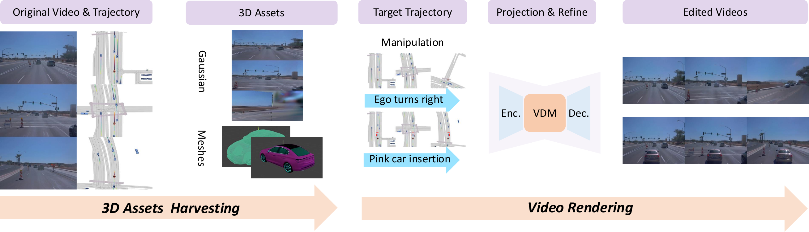
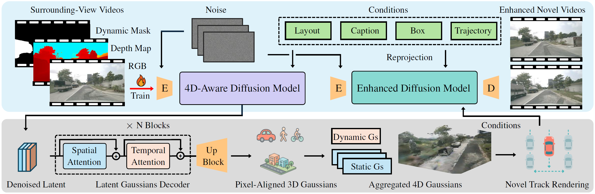
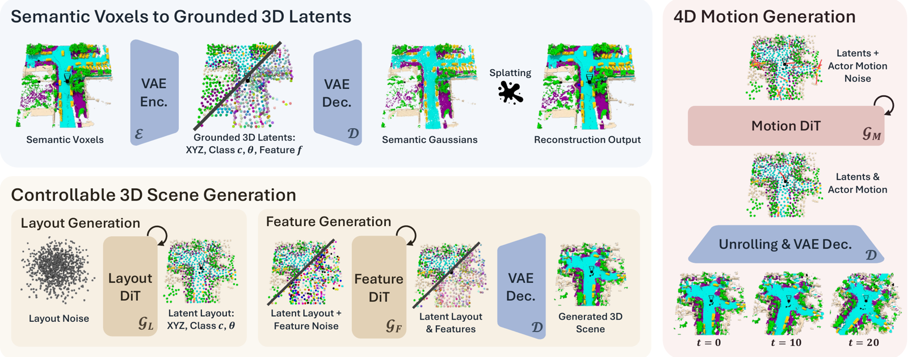

# DriveCompose 总览图：2026 年相关论文视觉参考

检索与图像检查日期：2026-10-20。本次选择三篇可直接获得原始总览图的近期相关工作，按构图、机制表达和三维表示三个角色提取设计原则。图中科学内容仍以 DriveCompose 源码与论文方案为准。

## HorizonForge · CVPR 2026

[作者项目页](https://horizonforge.github.io/) · [原始总览图](https://horizonforge.github.io/static/images/fig-trimmed.png) · [CVPR 正式条目](https://openaccess.thecvf.com/content/CVPR2026/html/Wang_HorizonForge_Driving_Scene_Editing_with_Any_Trajectories_and_Any_Vehicles_CVPR_2026_paper.html)

实际可见：从驾驶视频与轨迹到三维资产、目标轨迹、投影与生成，再到编辑视频的横向阅读路径；道路、地图和车辆资产承担主要信息，模块名保持简短。

采用的原则：用可识别的空间对象说明输入和输出，让资产在转换前后具有连续身份。DriveCompose 的完整世界同样需要被画成场景与资产，不能只写成一个名称框。

不迁移：该文的视频扩散渲染、mesh harvesting、具体道路画面、原布局坐标与原始结果。

## WorldSplat · ICLR 2026

[作者项目页](https://wm-research.github.io/worldsplat/) · [原始总览图](https://wm-research.github.io/worldsplat/assets/framework.png) · [论文](https://arxiv.org/abs/2509.23402) · [ICLR 正式条目](https://proceedings.iclr.cc/paper_files/paper/2026/hash/6fa4a1def9d60b5bf6078e13c900c45c-Abstract-Conference.html)

实际可见：上层为生成主流程，下层展开潜码到高斯表示的机制；特征、算子、静态 / 动态高斯和新轨迹渲染使用不同图形载体。

采用的原则：宏观流程和核心机制具有不同阅读层级；局部机制通过表示变化讲清楚。DriveCompose 的中部展开局部分组、全局记忆和每步观测约束。

不迁移：该文的 4D-aware video diffusion、Enhanced Diffusion Model、时空注意力拓扑与图中训练标记。

## LatentWorld · CVPR 2026

[作者项目页](https://jindapark.github.io/projects/latentworld/) · [原始总览图](https://jindapark.github.io/projects/latentworld/static/images/method.png) · [会议论文条目](https://openaccess.thecvf.com/content/CVPR2026/html/Park_Grounded_Latents_for_Entity-Centric_4D_Scene_Generation_CVPR_2026_paper.html)

实际可见：语义体素、空间潜码、高斯、解码器和输出场景具有不同的视觉形态；右侧时序分支表达同一实体表示随运动改变。

采用的原则：空间表示要有位置和对象身份；资产控制通过同一身份的姿态变化表现。DriveCompose 采用规范车辆、规范人体、已见 / 未见表面以及固定世界到多种状态的分支。

不迁移：该文的语义占据目标、layout / feature / motion 三阶段生成、运动预测、原场景点云与原配色语义。

## 本次合成的视觉语法

- 左到右的空间表示转换；中间联合补全占最大解释面积。
- 观测、空间支撑、潜码、算子、固定世界和状态使用不同图形载体。
- 蓝色表示已见，橙色表示补全，灰色表示未知，空心斜线单元表示自由空间。颜色表示观测状态，资产类别由几何形状、行和标签区分。
- 背景、车辆、人体的局部信息通过全局记忆交换；已见潜码在每步更新后锁定，空域在潜码与高斯不透明度层面受约束。
- 在线动作只更新当前状态，固定世界内容不进入在线重新生成回路。
- 原论文图像保留为参考材料并标注出处，没有作为 DriveCompose 的实验结果或直接拼接内容。

还检索了 Gen3R（CVPR 2026）等相关项目。本轮其项目页没有提供可直接识别的静态 method overview，未将其结果图代替总览图，也未计入上述已检查视觉参考。

原图版权归各论文作者或权利人；本目录保留用于本地研究与风格分析，未声称这些参考材料属于 DriveCompose。
