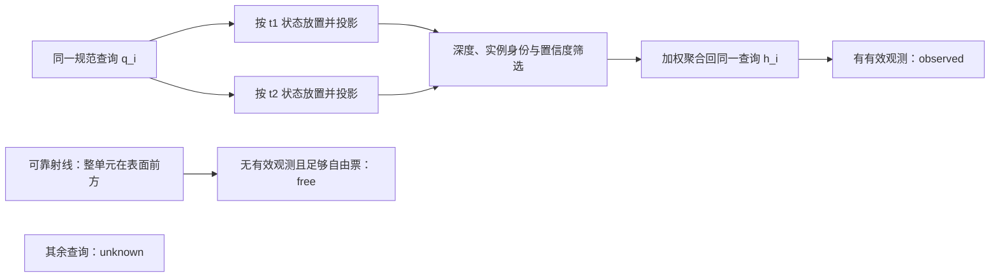

# DriveCompose 论文优化工作流

建立日期：2026-10-25。目标：CVPR 2027 main track，约 8 页正文。标题已固定；引言首轮修改后，按用户新要求澄清贡献并开始摘要微调，待正文稳定后再终校。仓库执行入口是根目录 [AGENTS.md](../AGENTS.md)。

**修改原则：继承当前稿件，以局部微调为主。** 准确清楚的内容保持原样，只修确有问题、冗余或解释缺失的位置。每轮优化积累已有改进，不重新生成整节。

## 1. 已有技能与使用方式

以下技能已在本次会话的本机目录中找到。通过技能名称定位实际 `SKILL.md`，不要把本机绝对路径写进仓库。CCFA 技能先加载 `ccf-humanization` 与 `ccf-common`，并复用已生效的规则。

| 技能 | 何时用 | 交付与边界 |
| --- | --- | --- |
| `ccf-pipeline-orchestrator` | 当前阶段、章节顺序与整稿压缩 | 维护本工作流，明确本轮范围和下一步 |
| `anti-defensive-writing-en` | 默认贯穿结构组织、改写、压缩与实验叙述 | 围绕有证据的核心优势组织论证，删除过程汇报和无依据的自我削弱 |
| `ccf-paper-reviewer`，writing 模式 | 改写前及重要修改后 | 找到具体段落问题和可操作的修正，不替写、不默认给录用分 |
| `ccf-paper-writer` | 引言、相关工作、方法、实验分析、最后的摘要 | 直接更新 LaTeX，保留事实和技术含义 |
| `humanizer:humanizer` | 论证稳定后的语言检查 | 删除模板化句式、夸饰和冗余；不以 AI 检测分数为验收标准 |
| `ccf-integrity-auditor` | 数字、引用、术语或图文冲突 | 核对已存在的证据，不生成新结果 |
| `ccf-submission-checker` | 压缩收尾和投稿前 | 官方规则、模板、匿名性、页数、元数据和材料检查 |
| `oral-paper-skill`（按需） | 学习指定优秀论文的引言组织 | 提炼写作逻辑；核验论文来源，不模仿句子或挪用结论 |
| `ccf-literature-searcher`（按需） | 某个相关工作差异需要核验 | 找原论文或官方材料，不把检索数量当作贡献 |
| `ccf-visual-composer` / PDF 技能（按需） | 图表占位过大、浮动失序或可读性问题 | 尽量重用已完成图件，保持内容和实验值 |

`anti-defensive-writing-en` 是默认叙事约束；`humanizer` 负责最后的语言检查。前者检查“现有内容是否清楚呈现核心价值”，后者检查“是否存在具体的空话、重复或不自然表达”。检查通过的内容原样保留，发现问题才做局部修改，避免让多个技能反复替换同一段落。

实施时保留影响科学判断的真实结果、局限和必要披露，不虚构权衡或改变评价条件。标题固定及用户当轮指定的修改范围优先于技能中的整稿重组建议；摘要已按后续明确要求开始处理。

本次尝试了技能安装器的外部 curated 目录查询，返回 HTTP 403；未安装外部技能。现有本地技能已覆盖所需工作。若以后确需新技能，再核对来源、内容与授权。

可直接使用的请求：

- “按 AGENTS.md，保留引言现有好内容，定位具体冗余、歧义和缺失解释，做最小必要微调并同步中文，暂不改摘要。”
- “用 writing 模式审查这轮引言，只检查问题、缺口、见解、贡献和证据是否连贯。”
- “按 8 页预算提出方法节压缩方案，列明保留、合并和补充材料候选，暂不删除。”
- “按 CVPR 2027 官方要求检查投稿包，区分通过、未核验和待处理。”

## 2. 当前基线与压到 8 页的具体方案

更新：2026-10-25。已执行第一批 §3.6 和第二批 §3.2/§3.5：训练细节、标准变换和前端实现分别保存在双语补充材料 B/C/D；其余压缩候选尚未执行。实际修改见 [改动对照](paper-revision-changes.md)。

**最新英文实测：** 本轮 §3.2 约 0.72 → 0.60 页，§3.5 约 0.51 → 0.36 页；Method 约 2.97 → 2.69 页；正文约 8.64 → 8.41 页当量。正文仍结束于第 9 页，位置由右栏提前到左栏；英文主稿含参考文献 12 → 11 页，补充材料 2 → 3 页。其余章节待用户指定范围，不自动推进。以下预算表保留最初压缩前基线；它是原计划，不是最新占用。

### 2.1 压缩前基线与目标

**篇幅验收只针对英文主稿。** 中文稿仅同步语义，不按中文页数制定压缩目标；英文和中文补充材料独立提供，不计入英文正文 8 页。以下全部页数预算、节省估计和验收判断均指英文主稿。

压缩 §3.6 前，英文正文 PDF 共 12 页，参考文献从第 10 页开始；结论在第 9 页右栏开始，约 8 行续至第 10 页左栏。不能用总页数减去整页参考文献来声称正文已合规。

以下按当前双栏 PDF 的标题位置、正文终止位置和图表范围估算“页当量”：一页按两栏、每栏约 648 pt 计。跨栏 Figure 1 统一归入前部内容；保留标题区占用与实际留白。因此数字用于分配删减预算，不等于正式页数验收，也不保证浮动重排后的精确收益。正式通过条件仍是正文及全部正文图表在第 8 页结束。

| 内容 | 当前约占页当量 | 计划预算 | 预计减少 |
| --- | ---: | ---: | ---: |
| 标题、摘要、引言、Figure 1 | 1.54 | 1.55 | 本轮稳定内容先保留 |
| Related Work | 0.65 | 0.55 | 约 0.10 |
| Method 正文，不含 Figure 1 | 3.40 | 2.45 | 约 0.95 |
| Experiments，含现有图表 | 3.23 | 3.10 | 约 0.13 |
| Limitations 与 Conclusion | 0.26 | 0.25 | 基本保持 |
| 合计 | **约 9.07** | **约 7.90** | **约 1.17** |
| 排版余量 | — | **0.10** | 留给浮动和换行变化 |

Method 占现有正文页当量约 37%，确实是首要压缩对象。目标是压缩外围实现和训练展开，同时保留联合补全、观测约束及可组合表示的完整推理链；不是按同一比例压缩所有小节。

### 2.2 Method 的具体取舍

下表保留最初方案的公式号，当前稿已自动重编号；具体映射见改动记录。A：跨数据集泛化、B：训练细节、C：场景装配与检查、D：视觉恢复与聚合均已建立；尚未迁移 §3.1/§3.3。

| 顺序与位置 | 当前占用约 | 正文必须保留 | 可压缩或移入补充材料的具体内容 | 预计节省 |
| --- | ---: | --- | --- | ---: |
| **P0：3.6 Training procedure**，第 5 页右栏至第 6 页右栏 | 0.90 页 | 四阶段顺序、每阶段更新/冻结哪些模块；同查询布局的完整目标；每个未知查询必须有有效目标；最后只适配补全网络 | Stage 1 的监督项和身份匹配细节；Stage 2 的 RGB/深度损失展开及公式 17–18；Stage 4 的完整接触、穿透、自由射线损失及公式 19–20、权重解释；掩码扰动与推理版本登记细节，迁入补充材料 B。正文用一个紧凑段落解释各阶段目的，引用详细训练配方 | **0.47–0.52 页** |
| **P1：3.5 Scene composition and observation consistency**，第 5 页 | 0.50 页 | 背景和规范资产固定、状态驱动变换；原始视角下候选场景与 observed-only 参考比较；新增遮挡为何仍需检查；退化定义公式 16 | 标准刚体中心/协方差公式 13、蒙皮及外观方向变换细节、奇异变换处理迁入补充材料 C；将公式 14 的装配渲染保留为简洁关系，外部策略/动力学递推公式 15 及后端道路/碰撞说明移入 C；完整检查项、归一化分母保留在 C，正文保留检查逻辑和作用范围 | **0.16–0.19 页** |
| **P1：3.2 Visual recovery and canonical aggregation**，第 3–4 页 | 0.72 页 | 背景、车辆、人体的支撑定义；规范坐标与参考世界坐标的用途；运动对齐；三种互斥掩码及观测筛选依据 | Patch/相机/时间嵌入、两级 Transformer、预测头逐项列举和 slot 实现细节迁入补充材料 D；保留运动放置公式 3 与聚合关系，门控常数和自由空间整单元投票不等式 6 的推导放 D；正文仍说明用可靠射线保守判定自由空间 | **0.16–0.20 页** |
| **P2：3.3 Structured latent representation and decoding**，第 4 页 | 0.28 页 | 类型专属编码/解码、共同潜码维度、所有权与绑定保留；逐查询固定解码为何保护已见参数；自由空间不透明度约束 | 子高斯中心参数化公式 7、方向外观系数及数值参数化细节移入 D；正文保留支撑内解码和参数保持性质 | **0.04–0.06 页** |
| **P2：Method 开头及 3.1**，第 3 页 | 0.47 页 | 输入/输出、世界与规范资产的关系、条件补全定义公式 2、场景状态与 flow time 的区分 | 开头逐小节导航精简；输入预处理、相机变换约定和 sky 元数据细节移入 D，正文保留影响问题定义的条件；去掉与引言重复的流程说明 | **0.03–0.05 页** |
| **重点保护：3.4 Conditional generative reconstruction**，第 4–5 页 | 0.53 页 | 局部组织与 CCM 的读写关系（公式 8–9）、unknown-only 路径（10）、学习目标（11）、硬投影采样（12）及三种掩码语义 | 只删重复定义和可由相邻公式直接读出的复述；不迁走解释核心创新所需的机制 | **0–0.03 页** |

合计预计节省约 **0.86–1.05 页**，以 **约 0.95 页** 作为预算目标。先处理 3.6，再处理 3.5 和 3.2；每一批编译后根据实际收益决定是否需要 P2，避免为追求估计值继续改动已经清楚的段落。

### 2.3 剩余约 0.2–0.3 页从哪里来

1. **Related Work：约 0.10 页。** 各段末尾现在反复解释 DriveCompose 的聚合、补全、观测保持与复用。合并这些重复的自我描述，保留与 OmniRe、生成式补全、结构化场景生成及视频/视图生成的直接差异。优先缩短铺垫，不删除最近邻的关键归因。
2. **实验说明：约 0.10–0.15 页。** 合并表注、协议和结果段对相同输入数、步数与指标的重复说明；精简逐格复述。若需迁移精确时间戳列表、种子列表等配置，可放补充材料 E；正文仍保留公平比较控制、未知区域定义、评测候选/接受分母以及关键评价设置。
3. **保留当前图件。** 首轮方案不重新绘制、不裁去方法行、不缩小图中文字，也不先删去五组样例。只在上述内容压缩仍不足时，再单独讨论代表性样例选择与补充材料分配；这部分不计入本计划的预期收益。

当前 State-driven reuse 主要是干预设置，尚未展示对应结果。若已有作者提供的状态变化结果，应优先用于支撑复用主张；本轮不虚构结果，也不把预留排版余量当成已经补齐的证据。

### 2.4 逐批执行与验收

- 第一批已完成：仅改 3.6，详细说明移入补充 B；双语对照、编译及版面检查通过，英文实际节省约 0.43 页。
- 第二批已完成：§3.5 标准变换迁入 C，§3.2 前端实现与自由空间判定式迁入 D；保留核心定义和完整观测检查。Method 减少约 0.28 页，整稿重排后正文减少约 0.24 页，双语编译和交叉引用检查通过。
- 第三批按实测缺口决定是否执行 3.1/3.3、相关工作和实验去重；不机械完成所有候选项。
- 每批都继承当前版本，保留原文基线并更新同一改动对照。先改源内容，不调整模板字号、边距、行距，不用负间距规避页数。
- 主稿与补充材料分别编译，正文中的所有图表必须在第 8 页结束；从正文迁出的内容必须在补充材料真实存在并能定位。
- 官方模板和匿名 LLM Usage Statement 仍需在投稿包阶段完成核查。声明放正文之后、参考文献之前且不计入 8 页，不从核心内容预算中挤占。现有样式是项目继承的 CVPR 样式，本轮没有把整稿迁换成新 author-kit。

规则依据（2026-10-25 核验）：[CVPR 2027 Author Guidelines](https://cvpr.thecvf.com/Conferences/2027/AuthorGuidelines)。主稿最多 8 页、含图表；补充材料允许独立提供额外分析。补充材料没有强制双栏要求，本项目按用户要求沿用 CVPR 双栏格式。核心论证仍应在主稿独立成立。

### 2.5 方法图示候选（本轮仅讨论，未插入论文）

Figure 1 已承担总体流程。优先细化其 (a) 的规范聚合，而非新增重复流程图：展示同一规范查询在两个观测时刻的放置/投影、深度与身份筛选，以及聚合回同一资产支撑。三种互斥状态应使用稳定图例；未知区域不能自动画成自由空间。概念草案：

另一个候选是 §3.5 的遮挡检查 inset：在同一原始相机和资产状态下并列 observed-only 与 completed candidate，标出新增表面遮挡原有内容的局部区域，再展示正退化比较。图的任务是解释“参数保持为何仍需渲染检查”；不能替代正文的指标定义、归一化分母和接受条件，也不表示已验证新状态或闭环安全。

本轮没有创建或插入正式图件，现有 Figure 1 与所有实验图保持原样。后续若采用图示，应同时确认其替代哪些文字、使用现有版面还是新增空间，再编译评估净篇幅。

## 3. 执行顺序和通过条件

| 阶段 | 当前状态 | 本轮工作 | 通过条件 |
| --- | --- | --- | --- |
| 工作流建立 | 本次完成 | 固定范围、技能、预算与投稿提醒 | AGENTS.md 可指导后续会话，无需猜测标题和摘要偏好 |
| 引言 | 首轮微调及贡献澄清已完成（2026-10-25） | 按作者反馈，将两条贡献区分为框架能力和补全机制，移除贡献中的消融数字；摘要与实验保留证据，其余引言沿用首轮结果 | 本轮只改两项贡献，引用对应，双语编译与受影响页面检查通过 |
| 相关工作 | 待处理 | 按最近邻差异重组，核查关键归因 | 引言的缺口有文献依据，避免把已有能力写成本文首创 |
| 方法 | 待处理 | 按理解依赖解释表示和机制，压缩重复 | 能复原核心链路，符号和公式一致，贡献与实现不混淆 |
| 实验与图文 | 已迁出跨数据集结果，其余待处理 | 原英文 4.4 与表 3 移入独立双语补充材料 A；主稿概述及摘要同步 | 迁移前后数值一致；其余主要结论有图表支持 |
| 整稿压缩 | 已建立具体方案，尚未执行方法压缩 | 优先 3.6、3.5、3.2，预计从 Method 节省约 0.95 页；见第 2 节 | 正文和图表不超过 8 页，必要技术内容仍完整 |
| 摘要与结论终校 | 已按用户要求开始摘要微调；最终终校待正文稳定 | 保留摘要开头，凝练联合补全直觉，保留 Waymo 外推及 CCM 消融结果，nuScenes 结果已随实验迁至补充材料 | 英文 150–250 词，双语对应，数字和能力主张可定位到正文证据 |
| 投稿包检查 | 待处理 | 官方模板、匿名性、声明、注册与补充材料 | 所有必要项有实际检查依据；未知事项明确列出 |

一轮只集中处理一个章节，必要时修改其依赖；审查只报告实际问题，写作只改对应位置。优先删冗词、修句内表达、补必要连接；整段重写和章节重排需说明必要性并获得明确授权。读写角色可由同一个代理顺序承担，无需自动多代理或多轮打分。

每处修改需能说明“原问题 → 最小改动 → 明确收益”。若只是另一种同样可用的表达，保留原句。已解决的位置不重复翻修，除非新证据、新要求或具体缺陷需要重开。问题修复并检查通过即停止，不用新的风格偏好解构上一轮成果。

### 每轮可见的交付

1. 开始修改前，用简短清单指出具体问题及位置。
2. 修改后打开目标章节的 Git 差异视图，直接查看删去和新增的文字。
3. 更新唯一的 [本轮改动对照](paper-revision-changes.md)，列明真实基线、原文、修改后、理由、中英文对应及保留项。正文对照与分页、引用等技术改动分开。
4. 在回复中展示代表性对照，并给出完整记录与最终 PDF，避免要求用户自行猜测改动。

引言首轮的对照基线为 `ee5b6cb`；该轮开始时两份引言源文件没有其他未提交改动。贡献和摘要这一轮从首轮结束后的未提交工作区开始，各轮真实起点保存在 `paper/build/revision-baseline.json`；最新贡献调整的起点为其中 `contribution_revision_before`。完整对照同时展示首轮前与当前引言，并单独标明本轮只改变两项贡献。以后继续保留真实起点，不能把更早的 HEAD 当成本轮基线，也不能把用户已有改动当成本轮修改。

引言首轮已将三个状态变化案例合并为一句，按前馈恢复、可组合表示和生成补全概括已有工作，明确“恢复已观测内容本身不提供未见表面”的缺口，并解释组件控制坐标系为何有利于跨状态保持内容身份。删除引言中与方法节重复的双坐标解释、聚合复述和训练步骤，保留原段落顺序、两项贡献、关键归属表述及 Figure 1 引用，补入论文组织说明。后续仅复核新增问题，不重开已通过的措辞。

## 4. CVPR 2027 官方要求与提醒

核验日期：**2026-10-25**。以下来自当届官方页面，不能由本地旧版 venue guide 覆盖；正式投稿前重新核验。

### 篇幅、模板和材料

- 正文上限 **8 页，含图表**。额外页面只能承载引用文献和必需的 **LLM Usage Statement**；不能把附录接到主 PDF 的额外页而假设自动豁免。[官方作者指南](https://cvpr.thecvf.com/Conferences/2027/AuthorGuidelines)
- 当届官方指南已提供 **CVPR 2027 Submission Template** 下载入口。本仓库沿用旧样式、修改年份的状态不等于通过模板检查；模板文件尚未逐项比对，进入整稿压缩前需要核对字号、边距、样式与匿名模式。[模板入口](https://cvpr.thecvf.com/Conferences/2027/AuthorGuidelines)
- **LLM Usage Statement 必须放在正文之后、参考文献之前**，说明实际使用的工具、涉及部分及用途；包含语言编辑，也包含生成式图像等用途。现有会话已使用 AI 辅助写作，项目总览图记录也涉及 Image Gen，不能填写“未使用”。具体工具和范围应与真实记录核对，未知事实不代填。[LLM 政策](https://cvpr.thecvf.com/Conferences/2027/AuthorGuidelines)
- 保持双盲：正文、补充材料、PDF 元数据、链接及致谢不能暴露作者身份。引用须可核验；不通过外部链接扩展提交内容。[作者指南](https://cvpr.thecvf.com/Conferences/2027/AuthorGuidelines)
- 补充材料可包含更多图表、视频、证明和实验细节，但审稿人不必阅读；主论文保留判断贡献所需的信息。[补充材料政策](https://cvpr.thecvf.com/Conferences/2027/AuthorGuidelines)

### 日期

官网用 **AoE（UTC−12）**。下表将当地截止日末时刻换算为北京时间（UTC+8）；正式操作以 OpenReview 显示为准，并提前完成上传。

| 事项 | 官网日期（AoE） | 北京时间对应截止 |
| --- | --- | --- |
| 论文注册 / 摘要登记 | 2026-11-10 23:59 | 2026-11-11 19:59 |
| 完整论文提交 | 2026-11-16 23:59 | 2026-11-17 19:59 |
| 补充材料提交 | 2026-11-23 日末 | 2026-11-24 约 20:00 前 |

补充材料页面只标日末 AoE，精确到秒的时间应在系统再次确认。[官方重要日期](https://cvpr.thecvf.com/Conferences/2027/Dates)；[官方征稿页](https://cvpr.thecvf.com/Conferences/2027/CallForPapers)。

审稿意见公布：2027-01-25 AoE；rebuttal：2027-01-25 至 02-01 AoE；最终决定：2027-02-25 AoE。Rebuttal 上限 1 页，届时另建对应任务。[官方征稿页](https://cvpr.thecvf.com/Conferences/2027/CallForPapers)；[作者指南](https://cvpr.thecvf.com/Conferences/2027/AuthorGuidelines)。

### 需要作者完成的事项

- [ ] 在摘要登记截止前建立 OpenReview 提交、填写标题摘要并加入全部作者。
- [ ] 全部作者完成 OpenReview profile、author enrollment、利益冲突及要求的同意项。无机构邮箱的新账户可能需要最多两周审核，应尽早处理。[征稿页](https://cvpr.thecvf.com/Conferences/2027/CallForPapers)
- [ ] 核对 reciprocal-reviewer 资格和投稿额度；资格依据 OpenReview 中列出的认可发表记录，不能仅提供 DBLP 链接。[作者指南](https://cvpr.thecvf.com/Conferences/2027/AuthorGuidelines)
- [ ] 摘要截止后不能增删作者；作者顺序须在完整论文截止前确定。[作者指南 FAQ](https://cvpr.thecvf.com/Conferences/2027/AuthorGuidelines)
- [ ] 将当前工程与官方 2027 模板逐项对照，保留已有源码与编译能力。
- [ ] 实际添加匿名 LLM Usage Statement；当前 `paper/main.tex` 尚未包含该节。
- [ ] 完成 8 页正文检查、图表检查和引用检查。
- [ ] 核对数据使用条件、图片来源、匿名材料和并行投稿状态；未知项由作者确认，不由代理推断。

提醒方式：后续开始整稿压缩、接近注册截止和进行投稿检查时，提示尚未完成的相关事项；这是工作流中的会话检查点，尚未创建定时通知。作者账户及 enrollment 状态未访问，不能视为已完成。

## 5. 文件与验收

- 正式源稿：`paper/main.tex` 与 `paper/sec/`；中文对照：`paper/main_zh.tex` 与 `paper/zh/`。
- 正式主稿为 `paper/build/en/main.pdf`、`paper/build/zh/main_zh.pdf`；独立补充材料为 `paper/build/supp-en/main.pdf`、`paper/build/supp-zh/main_zh.pdf`。每种语言、每种材料只保留一个正式 PDF。
- 语言修改用 Git 差异核对；检查段落主张、数字、单位、引文、公式和图表含义。运行现有检查时，将缺少项目外历史归档与本轮编译错误分开说明。
- 生成 PDF 后检查受影响页面，不能只检查退出码；整稿收尾逐页检查并记录最后一个正文图表、局限性和结论所在页。
- 工作流建立后的引言首轮微调、贡献澄清和摘要微调已完成；标题保持不变。贡献及摘要本轮修改范围和全文对照见 `paper-revision-changes.md`，未自动提交或推送。
